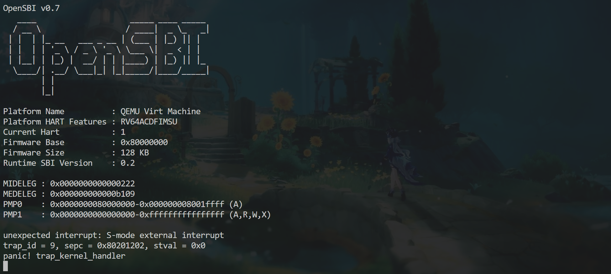
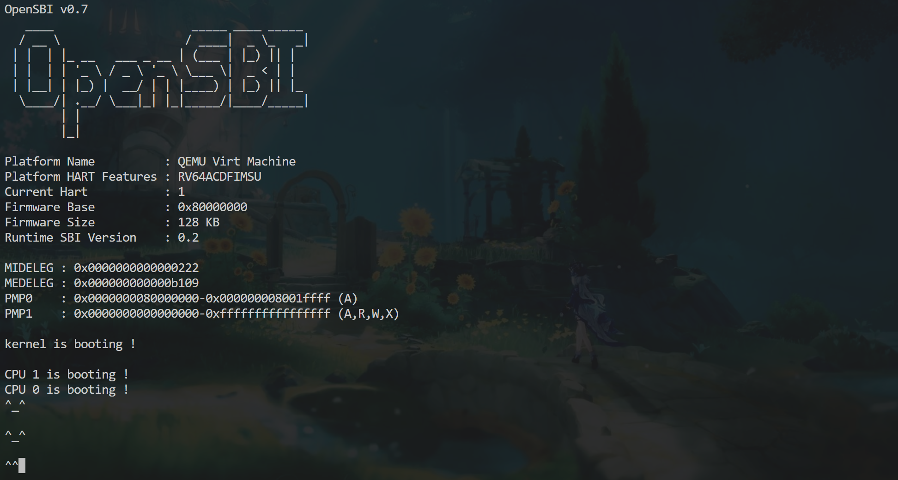
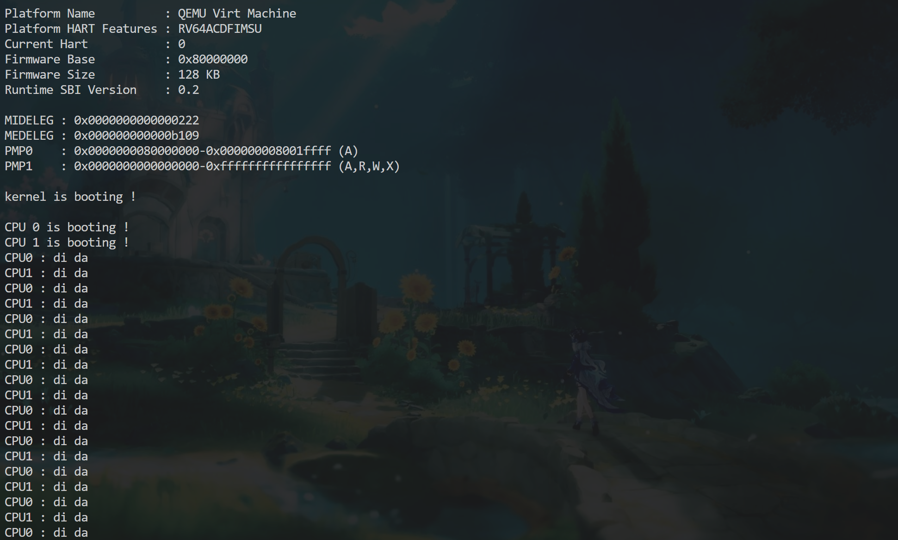
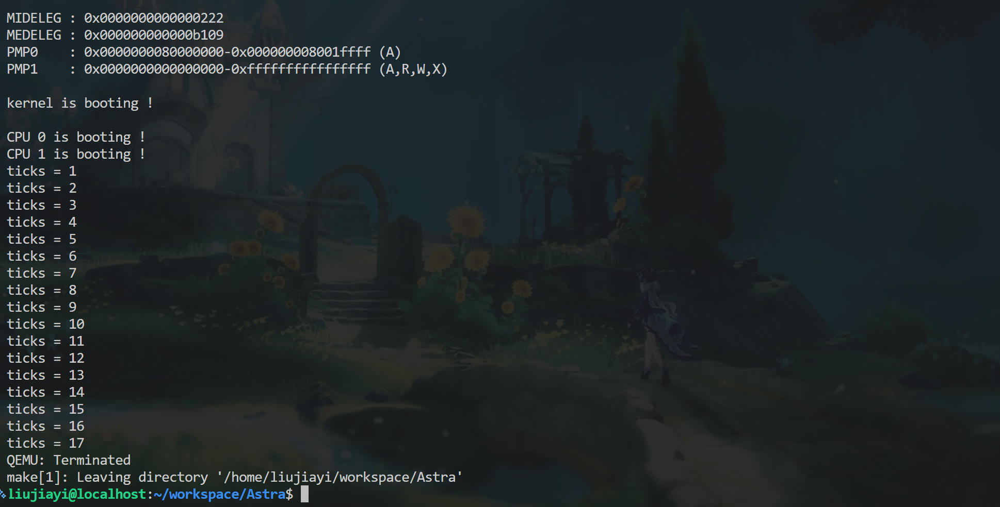

# Lab 3：中断异常初步

本实验在 `lab3` 分支完成。本文按照我实际阅读代码、编写和调试的顺序记录，依据是开发时与 Codex（GPT）的对话、当时贴出的终端输出，以及仓库当前实现。我先自己写代码，再请 Codex 检查；不理解的概念也通过提问逐步弄清。运行测试由我在 QEMU 中手动完成，Codex 做过源码检查和不生成目标文件的编译语法检查。

## 1. 同步框架，先理解这次要接通什么

开始前，我手动复制、覆盖了教师仓库 lab3 要求更新的文件，再请 Codex 按教师 README 核对。当时两个仓库都在 `lab3` 分支，标记为 `NEW`、`CHANGE` 的七个内核文件逐字节一致：`arch/method.h`、`arch/sbi.c`、`arch/type.h`，以及 `trap/plic.c`、`trap/trap.S`、`trap/method.h`、`trap/type.h`。三个 TODO 文件也都存在。这个检查只确认框架同步，没有把 TODO 与教师文件不同当成错误。

我先问了 trap、中断和异常的区别。最初我以为中断也需要执行某条指令才能触发，后来才理解：UART 收到数据等硬件事件可以独立发出中断请求；异常则由当前指令同步触发。Lab 3 的主要工作，是让已经在 S-mode 运行的内核接收并处理这些通知。

这次沿用 Lab 2 的 OpenSBI 启动路径，没有重新编写从 M-mode 切换到 S-mode 的代码。我先回看 `start.c` 和 `main.c`，再阅读 trap 初始化函数，区分共享初始化和每个 hart 都要执行的初始化。

## 2. 在 main 中初始化 trap，发现还有一层中断开关

我先在主核的 `kvm_inithart()` 后加入 `trap_kernel_init()` 和 `trap_kernel_inithart()`；其他核等待共享初始化完成后，只调用 `trap_kernel_inithart()`。Codex 检查认为调用安排正确：PLIC 的共享配置和共享时钟状态只初始化一次，各核分别设置自己的 trap 入口。

但检查也发现，当前框架中的 `trap_kernel_inithart()` 虽然配置了 PLIC、写入 `stvec` 并调用 `intr_on()`，却没有设置 `sie.SEIE`。我一开始不理解，因为 `intr_on()` 的注释写着“打开设备中断”，感觉已经足够。对照实现后才明确：

- `intr_on()` 设置 `sstatus.SIE`，是当前核在 S-mode 下的中断总开关。
- `sie.SEIE` 是外设中断这一类的开关。
- PLIC 还负责决定哪些设备请求可以送到当前核。

于是我在 `intr_on()` 前补上 `w_sie(r_sie() | SIE_SEIE)`，保留 `sie` 其他位，只开启外设中断。放在总开关前，是为了先准备好入口和各项配置，再允许响应中断；并不是说这两行在任何情况下都绝对不能交换。

我也质疑过：这个初始化函数看起来已经写好，老师是否在其他地方设置过 `SEIE`？Codex 重新搜索了当前源码，没有找到其他设置位置。但后来教师仓库已不在原来的相邻目录，无法再次对照其原文件，因此这里只记录当前 Astra 框架的缺项，不直接断言教师最新版本一定有同样问题。

## 3. 继续检查头文件，补齐架构和库接口

准备使用 `w_sie()` 时，我发现 `trap_kernel.c` 只包含 `mod.h`，而原代码本来就在调用 `w_stvec()`。我请 Codex 检查引用链，确认 `trap/mod.h` 经由 `type.h` 只引入了架构类型，没有引入定义这些寄存器操作函数的 `arch/method.h`。

我选择在 `trap/mod.h` 中加入 `../arch/mod.h`。第一次补完后，Codex 的语法检查仍报告 `assert`、`printf`、`panic` 和 `mycpuid` 缺少声明，于是又加入 `../lib/mod.h`。这些是内核自己的接口，没有按编译器的通用提示去包含标准库的 `stdio.h` 或 `assert.h`。

这个过程也让我意识到：函数原先就出现在框架里，不代表当前头文件依赖一定完整。Codex 最初检查初始化时也没有及时指出这些已有调用的依赖问题，后来是沿着引用链逐项确认的。

## 4. 刚打开中断就 panic：处理函数还没接上

完成初始化后，我运行 QEMU，遇到了下面这段实际输出：

```text
unexpected interrupt: S-mode external interrupt
trap_id = 9, sepc = 0x80201104, stval = 0x0
panic! trap_kernel_handler
```

当时我很困惑：只初始化了中断，而且没有按键，为什么就发生外设中断？检查发现 `print_init()` 会调用 `uart_init()`，而 UART 初始化已经同时启用了发送和接收中断：

```c
WriteReg(IER, IER_TX_ENABLE | IER_RX_ENABLE);
```

UART 的发送保持寄存器为空时也可以请求中断，不必等到输入字符。CPU 总开关打开后，就可能立即响应已经等待的请求。这为启动时的中断提供了合理解释，但当时没有读取设备中断号和 UART 状态来确认，因此不能把这次请求确定写成发送空中断。

能够打印上述信息，说明这次运行已经进入 `kernel_vector` 并调用了 `trap_kernel_handler()`。当时中断分类的 `switch` 还只有 `default`，收到外设中断自然会打印错误并 `panic`。这次报错让我看清了“允许中断进入”和“实现中断处理”是两个步骤。



## 5. 完善 UART 回显，弄清输入不等于 scanf

接着我修改 `uart_intr()`。教师目录树没有给 `uart.c` 标 TODO，但正文明确要求完善 UART 输入函数，使其支持换行和 Backspace，因此我按正文要求继续实现。

这一阶段我反复问过 Codex：没有地方调用 `uart_intr()`，字符为什么还能到 UART？这和 `scanf()` 有什么关系？后来才分清：QEMU 的 `-nographic` 串口交互把终端按键送到模拟 UART；UART 可以先接收并暂存字符，内核调用读取函数才把它们取出来。当前没有 shell，也不会解释我输入的命令。`uart_intr()` 要做的只是读取和回显，而且此时调用链尚未接通，修改完还不能单独据此判断输入功能已经运行。

我也问过 Enter 是否一定对应数值 10，以及为什么不直接原样输出。最后采用了兼容常见编码的处理：

| 收到的值 | 回显处理 |
|---|---|
| `10` 或 `13`，即 `\n` 或 `\r` | 输出 `\r\n` |
| `8` 或 `127`，即常见的退格或 DEL 编码 | 输出 `\b \b` |
| 其他字符 | 原样输出 |

这里兼容四种编码是实现选择，教师正文只要求换行和 Backspace，没有逐个指定编码。Codex 前期说明没有把这两点分清，后面核对时作了纠正。

我最初还把 Linux 文件使用 `\n`、Windows 文件使用 `\r\n`，与串口终端控制混为一谈。理解回车负责回行首、换行负责下移一行后，才接受统一输出 `\r\n` 的做法。退格则不能只输出 `\b`：光标左移不等于擦掉字符，还要输出空格覆盖，再退回来。

## 6. 阅读 trap 入口，再接通 PLIC 和 UART

准备识别 UART 中断时，我继续阅读 `trap.S` 和 `trap_kernel_handler()`。最初把栈调整理解成“空出 32 个寄存器”，后来明确：寄存器是固定硬件，这里是在栈上预留保存空间，用 `sd` 备份通用寄存器值，调用 C 函数，再用 `ld` 恢复。RV64 的通用寄存器宽度为 64 位，因此每个保存位置占 8 字节。

我还逐项问了 `sepc`、`sstatus`、`scause`、`stval` 和两个断言的作用。进入 S-mode trap 时，硬件记录原因和返回位置、更新部分状态位；汇编则负责通用寄存器现场。`SPP` 检查被打断的是 S-mode 代码，`intr_get() == 0` 检查中断总开关已关闭，并不意味着异常也不能发生。

随后我分两层识别来源：在中断的 `switch` 中用 `case 9` 识别 S-mode 外设中断，调用 `external_interrupt_handler()`；后者用 `plic_claim()` 领取设备中断，与 `UART_IRQ` 比较后调用 `uart_intr()`。`UART_IRQ` 在 `lib/type.h` 中定义为 10，是当前 QEMU virt 平台的设备中断号，与 `scause` 的类别编号 9 不同。

第一次写完请 Codex 检查时，发现了两处实际遗漏：

1. `case 9` 后没有 `break`。即便 UART 处理完成，程序仍会落入 `default` 并 `panic`。
2. 领取中断后没有调用 `plic_complete()`。处理结束需要通知 PLIC；返回编号为 0 表示没有领取到中断，不需要完成通知。

这两处是源码检查发现的逻辑问题，不是我贴出新运行报错后才定位的。补齐后，我手动编译运行并反馈没有发现问题，串口处理链路至此接通：

```text
kernel_vector → trap_kernel_handler → external_interrupt_handler
              → plic_claim → uart_intr → plic_complete
              → 恢复现场并返回
```



## 7. 开始定时器：区分每核报时与共享 ticks

串口部分完成后，我先写 `timer_create()`，将 `ticks` 清零，并初始化 `system_timer.lk`。然后在主核和其他核的初始化路径中，分别于 `trap_kernel_inithart()` 后调用 `timer_init()`。当前框架已经提供了首次报时和开启 `STIE` 的实现，我主要补调用位置与其余计数逻辑。

教师注释一处说时钟全局共享，另一处又说每个 CPU 独享，我当时没有看懂。向 Codex 提问后，才明确两者指向不同对象：各 hart 有独立的下一次定时事件设置，但 `static timer_t system_timer` 在内存中只有一份，是共享的软件计数。`static` 限制文件内可见性，不是每核各复制一份。

因此，每个 hart 都设置并处理自己的报时，但只有 CPU 0 更新共享 `ticks`。这个限制已经放在 `timer_interrupt_handler()` 中，我没有在 `timer_update()` 内重复判断。

## 8. 计数接口漏锁，再补上周期报时

我第一次补 `timer_update()`、`timer_get_ticks()` 时，只写了计数加一和直接返回。Codex 检查指出，虽然只有 CPU 0 更新，其他核仍可能读取，共享数据的读写需要同一把锁保护。

随后我把更新改为“获取锁、加一、释放锁”；读取则在锁内保存到局部变量，解锁后再返回。当前读取中保留了一个多余的 `uint64` 转换，不影响结果。

我在 `trap_kernel_handler()` 中加入 `case 5`，调用 `timer_interrupt_handler()` 并 `break`。最后在该处理函数中、CPU 0 判断之外加入：

```c
sbi_set_timer(r_time() + INTERVAL);
```

这样每个 hart 都能预约自己的下一次报时，只有共享计数的更新限于 CPU 0。`r_time()` 读取的是硬件时间计数，`sbi_set_timer()` 设置当前 hart 的绝对计数目标，不是日历时间。`INTERVAL = 1000000` 的单位是硬件时间计数，换算成秒还需平台时间频率；本次没有实测该频率，不能直接把它写成确定的毫秒数。

## 9. 手动测试与目前保留的证据

实现完成后，我手动进行了滴答测试和快慢测试，两者都正常。测试输出放在 CPU 0 更新计数之后，避免各核重复打印；这是测试安排，不是限制其他核读取计数。

| 测试 | 当时的记录与结果 |
|---|---|
| 串口输入回显 | 修正外设处理后，我反馈 `make` 运行测试没有发现问题；测试中也检查、讨论了连续 Backspace 的行为 |
| 时钟滴答 | 我手动测试并反馈正常 |
| 时钟快慢 | 我手动测试并反馈正常 |





串口和时钟的核心实现已经完成。现有证据包括源码检查、语法检查、最初外设中断 panic 的文本，以及我对手动测试结果的反馈，当前 lab 已完成
