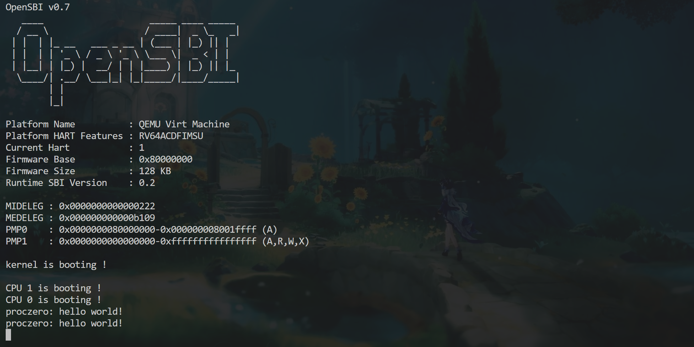
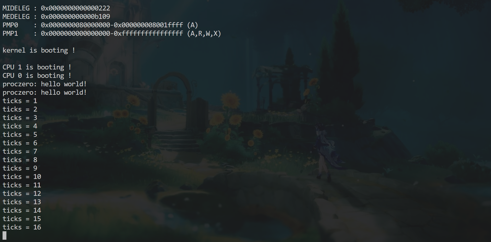
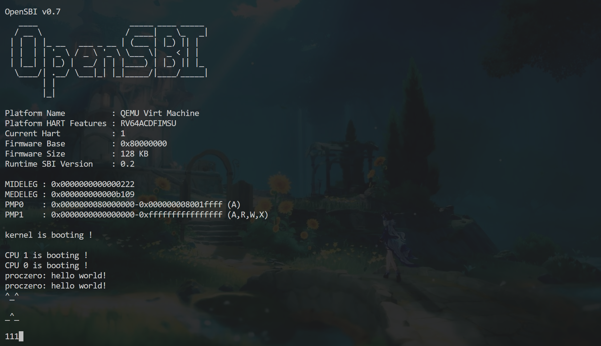

# Lab 4：第一个用户进程的诞生

本实验在 `lab4` 分支进行，沿用 Lab3 的 OpenSBI、内存管理和中断基础。本文按我实际编写代码的顺序记录，依据是开发时与 Codex（GPT）的对话、我贴出的构建输出、当前源码及本目录中的截图。代码由我分步骤编写，不理解的地方向 GPT 提问，再让它检查；部分局部写法和 YAML 契约也直接参考了 GPT 给出的示例。最后的用户异常处理及诊断数组边界修正，由我明确委托 Codex 直接修改，实验报告也由 Codex 依据上述记录协助整理。运行由我在 WSL 的 QEMU 中手动完成，不能把源码检查当成运行测试。

## 1. 同步教师文件

开始前，我手动把相邻教师仓库 `ecnu-oslab-2026-task` 的 Lab4 配套文件复制到 Astra，并将教师 README 保存为 `README-teacher.md`，再请 Codex 检查。检查时两个仓库都在 `lab4` 分支，教师 README 副本一致；但发现 `main.c` 没有覆盖，另外实际教师目录中有 README 文件树漏列的 `trampoline.S`、`user.ld`，Makefile 也增加了用户程序构建规则。

更重要的问题是：直接覆盖 `trap_kernel.c` 会把我 Lab3 写好的中断处理替换成空模板。Codex 最初只检查文件是否一致，没有及时区分“同步成功”和“保留已有功能”。发现后我手动 restore 了这个文件，明确采用下面的处理原则：教师提供的接口、结构和配套同步；自己写的核心逻辑保留；一个文件兼有两者时，只合并新增部分。

最终 `trap_kernel.c` 保留 Lab3 的中断分发、UART 和定时事件重设，只去掉两个提示数组前的 `static`，供 `trap_user.c` 的 `extern` 声明使用。同时补齐 `trap/mod.h` 的内存和锁模块依赖。之后 Codex 对照 `lab3` 分支确认，之前的启动、内存、锁、打印、UART、PLIC、时钟实现没有被空模板替换。教师目录中的 `.DS_Store` 是 macOS 元数据，我没有复制。

## 2. 先读结构体和地址布局，再写页表初始化

我先问清楚用户栈、用户堆、进程页表和内核栈的区别。最初以为“用户页表”本身也要从用户区申请，后来才理解：页表是内核管理的映射结构，从 `pmem_alloc(true)` 分配；用户代码页和用户栈页才从 `pmem_alloc(false)` 分配。页表里存的是地址和权限，不是代码或栈数据本身。

trampoline 和 trapframe 也是这一阶段才逐渐弄懂的：前者是切换页表时仍可连续执行的汇编代码，两张页表在同一高虚拟地址映射同一个物理页；后者是保存用户寄存器现场的内存页，内核通过 `proc.tf` 访问，入口汇编通过用户页表中的 `TRAPFRAME` 访问。映射在用户页表中不等于允许用户访问，这两页都不设置 U 位。

教师要求填写 spec，我先学习 `pre`、`effects`、`post` 分别表示调用前条件、状态影响、完成后的保证，也问了 `effects: []` 为什么是空列表。我先尝试填写 `proc_pgtbl_init` 的简略契约，再根据 GPT 的检查补充地址、权限和资源边界。后来请 Codex 补充了 `proc_make_first` 的契约和内存模块实现差距说明。本次主要由我按讨论结果手写 C 代码，最后两项修正由 Codex 直接修改；没有使用 YAML 自动生成代码的流程。

接着实现 `proc_pgtbl_init()`：申请清零的根页表页，映射 trampoline 和 trapframe，返回根页表指针，由外部保存到 `proczero.pgtbl`。我最初直接操作 `proczero.pgtbl`，经讨论后改成局部变量，避免初始化函数绑定某个具体进程。

第一次检查发现，我把 trapframe 权限也写成 `R | X`，并漏了 `return` 后的分号。修正为 trampoline 用 RX、trapframe 用 RW，两者均不带 U。检查还发现 Lab2 的 `vm_mappages()` 只处理 R/W/X，没有处理 U，我补上了从 `perm` 写入 U 位的逻辑。原来的内核映射无需修改，后续用户代码和栈的映射才显式传 `PTE_U`。

## 3. 逐项构造 proczero

我按“PID、trapframe、用户页表、用户栈、代码、初始现场”的顺序写 `proc_make_first()`，多次把局部代码发给 GPT 检查。

用户栈部分曾把栈页当成页表页，使用 `pgtbl_t` 和 `pmem_alloc(true)`，权限也写成 RWX。后来改成从用户区分配普通内存页，映射在 `VA_MAX - 3 * PGSIZE`，权限为 RWU。已经分配一页，`ustack_npage` 应为 1，我最初写成了 0。

`heap_top` 也曾误设成用户栈底。GPT 指出后，我追问为什么应放在 `0x2000`，再对照 `user.ld` 和 `proc.c` 注释确认：用户代码从虚拟地址 `0x1000` 开始，最低一页不映射，代码和数据预留一页，因此初始堆顶是 `0x2000`。这只是初始边界，本次没有实现 `malloc/free` 或额外分配堆页。

用户程序不是把 C 源码复制进内存，而是使用构建得到的字节数组。Makefile 将 `initcode.c` 编译链接为 ELF，再提取原始二进制并生成 `initcode.h`；内核分配用户物理页，建立到用户虚拟地址 `0x1000` 的映射，再用 `memmove()` 将数组复制到该物理页。复制前增加了 `initcode_len <= PGSIZE` 检查。

这里又出现过两个源码问题：代码页漏加 U 位；把 `heap_top` 改成 `0x2000` 后，映射调用仍使用它，导致代码映射位置与入口 `0x1000` 不一致。后来将代码映射地址明确写为 `0x1000`，并补上物理页指针到 `uint64` 的转换。这些是源码检查中发现并修正的，没有对应的实际页故障输出。

初始用户现场设置为：`tf.sp` 指向用户栈顶，即 `VA_MAX - 2 * PGSIZE`；`tf.user_to_kern_epc` 为 `0x1000`。我一度疑惑后者注释明明写“保存的用户 PC”，为什么要填入口。后来理解：第一次没有旧现场，内核需要人工构造一份现场；之后发生 trap 才保存真实用户 PC。

## 4. 补内核栈映射，弄清 swtch 怎么进入新执行流

随后设置 `proczero.kstack`、`ctx.sp`、`ctx.ra`。我最初没有找到 `KSTACK()`，还把它当成函数。它实际是地址宏：

```c
#define TRAMPOLINE (VA_MAX - PGSIZE)
#define TRAPFRAME  (TRAMPOLINE - PGSIZE)
#define KSTACK(i)  (TRAMPOLINE - ((i) + 1) * 2 * PGSIZE)
```

每个内核栈只占一页，宏中的两页间距是“一页栈、一页未映射的保护页”，不是两页栈，更不是每张页表的大小。

在 `kvm_init()` 中，我保留旧映射，再为 trampoline 和 `KSTACK(0)` 建立映射。期间曾把 trampoline 的物理地址也填成大写 `TRAMPOLINE`，后来修正为小写汇编符号 `(uint64)trampoline`：大写是高虚拟地址，小写是实际代码符号。另外，申请一页内核栈后，我曾映射 `2 * PGSIZE`，经检查改为一页，避免映射到未分配的下一物理页，也保留保护页。

我还问过：`swtch` 的 old 是否要手动逐个复制寄存器，为什么汇编里没有直接调用 `trap_user_return()`？最后对照汇编理解了：`swtch(&mycpu()->ctx, &proczero.ctx)` 自己保存和恢复 ra、sp、s0～s11；将新 ctx.ra 设为 `trap_user_return` 地址后，最后的 `ret` 就跳到那里。ctx.sp 则设为内核栈顶。在所有资源准备好后，补上 `mycpu()->proc = &proczero`，让后续 `myproc()` 能找到进程。

## 5. 实现 trap_user_return，逐个理解寄存器

这一部分我一开始基本没有看懂，按 GPT 的提示分步写完后，又重新追问了每个操作的原因。

先 `intr_off()`，通过 `myproc()` 获取进程，填写 trapframe 中的内核页表配置、内核栈顶、处理函数地址和 hart ID。我曾将处理函数字段写成 `(uint64)trap_user_handler()`，这会调用函数，而不是保存地址，修正为不带括号的函数名。

接着设置三个寄存器：

| 操作 | 我最终理解的作用 |
|---|---|
| stvec 指向高地址 user_vector | 安排用户运行后下一次 trap 的入口 |
| sepc 写入保存的用户 PC | 安排这一次返回用户态后从哪里执行 |
| 清除 sstatus.SPP、设置 SPIE | 准备 sret 返回 U-mode 及恢复中断状态 |

最后计算 `TRAMPOLINE + (user_return - trampoline)`，调用高地址的 `user_return`，传入 `TRAPFRAME` 和 `MAKE_SATP(proc->pgtbl)`。GPT 给出了函数指针调用的局部写法，我据此完成代码。

我特别追问过为什么不能直接调用原来的 `user_return` 地址。原因是汇编中途会切换到用户页表，而用户页表不映射内核低地址；必须先在两张页表都有的高虚拟地址执行，切换后才能继续取指令。`MAKE_SATP` 也不是把整张页表变成整数，而是把根页表物理页号和 Sv39 模式编码成寄存器值。

## 6. 实现用户 trap 处理，纠正 ecall 分支

`trap_user_handler()` 先断言来自 U-mode，将 stvec 切回 `kernel_vector`，保存 sepc，再读取 scause 分类。中断复用 Lab3 的处理函数：5 号时钟、9 号外部中断。

我最初沿用 `scause & 0xf` 获取编号，经 GPT 提醒改成清除最高位，保留完整原因编号。还复制了一个未使用的 sstatus 局部变量，检查指出 `-Werror` 下会影响编译，随后删除。

写 ecall 时，我没有分清两个编号：异常号 8 表示“用户执行 ecall”，a7 中的系统调用号 0 才表示 `SYS_helloworld`。GPT 解释了用户头文件中 a7 传调用号、a0 接返回值的约定后，我实现了打印、成功返回 0、未知调用返回 -1，并把保存的 PC 加 4，避免返回后重复执行同一条 ecall。

实际检查发现，我把 `case 8` 放进了中断 switch，应该放在异常分支，后来移到了正确位置。case 内局部变量也用大括号包起来，输出文字修正为 `proczero: hello world!`。

这一阶段，用户异常的 default 仍打印信息并 panic。我问过是否可以先保留，当时选择先验证正常路径。后续再委托 Codex 修改这一分支，具体修改和验证边界记录在第 9 节。

## 7. 接通启动入口，解决 xxd 构建失败

准备编译时，Codex 检查发现 `main.c` 还没有调用 `proc_make_first()`。我包含进程接口，并在初始化和启动其他 hart 后，仅让 `cpuid == 0` 调用它；其他 hart 继续在内核循环。

随后我执行 `make clean`、`make build`，实际失败在生成 `src/user/initcode.h`：

```text
xxd -i -n target_user_initcode target/user/initcode.bin > src/user/initcode.h
Usage:
       xxd [options] [infile [outfile]]
...
make: *** [Makefile:114: src/user/initcode.h] Error 1
```

我把完整输出发给 GPT。输出显示本机是 `xxd 2021-10-22`，帮助列表没有 `-n`，因此判断是工具选项不兼容，而不是进程代码运行错误。按建议将规则改成 `xxd -i $< > $@`，并把 proc.c 的别名对应改成生成的 `target_user_initcode_bin` 和 `target_user_initcode_bin_len`。重新清理构建后，我启动 QEMU，得到下面的输出。



## 8. 两次 hello world、时钟和串口测试

看到两次 hello world 时，我又让 GPT 检查是不是两个 CPU 各打印一次。核对源码后确认：`initcode.c` 本来就连续调用两次 `syscall(SYS_helloworld)`，而首进程只由 hart0 创建，所以这是同一用户进程两次请求的预期结果。

我随后查看生成的机器码数组，其中有两组 `73 00 00 00`，对应两条 ecall。它也帮助我把用户 C 源码、生成数组、复制到物理页、通过用户页表执行这几个步骤联系起来。

第二张截图记录了 hello world 之后的 ticks 输出，从 1 连续增长到 16。结合默认 initcode 在两次调用后进入用户循环，以及当前只由 CPU 0 更新共享 ticks 的实现，这为用户运行期间时钟处理继续工作提供了证据。但截图没有展示每次中断的 PC 或寄存器，不能说已经逐项验证全部现场保存。



时钟测试后，我又进行了串口验证并补充截图。在两次 hello world 输出之后，终端仍能显示输入的字符和多行内容，截图中保留了字符图案及 `111` 的回显。当前 UART 中断可能由任一已启用它的 hart 响应，因此这张图证明用户进程运行期间串口回显仍可用，不单独证明此次 UART 中断一定打断了 hart0 的用户执行。静态截图也没有记录逐次按键，不能仅凭最终画面确认 Backspace 的擦除过程。



这里截图中的初始 hart 是 1，我保留了自己原有的主核原子选举启动方式；当前源码仍仅让 hart0 创建首进程。两核启动提示的先后顺序不代表创建了两个用户进程。

## 9. 当前结果与未完成项

| 项目 | 当前证据与结论 |
|---|---|
| 构建和启动 | 有 xxd 失败原始输出及 QEMU 运行截图；最后一次异常处理修改也已由 Codex 在 WSL 增量编译、链接通过，尚未重新运行 |
| 两次系统调用 | 实际观察到两次 hello world，与默认用户程序一致，正常往返已跑通 |
| 用户运行期间时钟 | 截图显示 ticks 从 1 增长到 16 |
| UART 输入回显 | 已补充用户进程启动后的串口验证截图，可见字符回显和多行内容；Backspace 具体操作过程未单独记录 |
| 未知系统调用 | 源码返回 -1，尚无专项运行证据 |
| 用户零页等异常 | 后续请 Codex 修改为诊断后清空 cpu.proc，在可响应中断的内核 wfi 循环中停止用户执行；保留资源，尚待专项运行验证 |
| 分配、映射失败与资源回收 | 仍采用现有 panic 路径，未实现教师 spec 要求的完整失败回滚 |

后续我明确请 Codex 修改用户异常处理和诊断数组越界问题。它为用户 trap 的两个提示数组访问增加了编号范围检查，并使用当前 printf 支持的 64 位 `%x` 打印编号和地址，避免原 `%d` 类型不匹配及 `%p` 截断地址的问题。修改后 Codex 在 WSL 执行 make build，trap_user.c 重新编译并成功链接；尚未运行零页访问专项测试，也没有新的运行截图。`usertrap.yaml` 已补齐两个函数契约并同步此次异常处理方式；内存模块 spec 中的失败回滚等目标仍未全部实现。

本次最主要的进展，是我亲手接通了“构造进程 → 首次进入用户态 → ecall 进入内核 → 返回用户态”的路径。过程中不少错误在源码检查时就修正了，实际保留下来的构建失败是 xxd 参数兼容问题，运行证据则是两次系统调用输出、时钟计数和补充的串口回显截图；本文没有把尚未做的测试写成已经完成。
